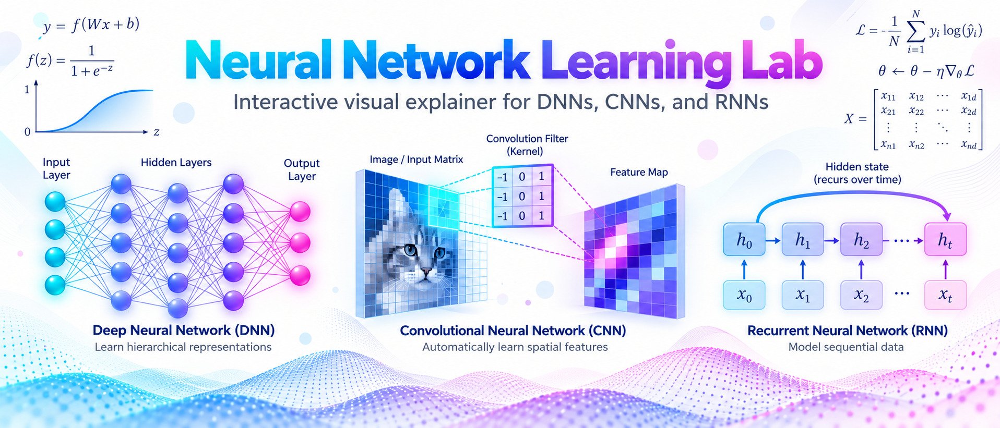

# Neural Network Learning Laboratory

<p align="center">
  <strong>An interactive, inspectable neural-network microscope for learning the mathematics behind deep learning.</strong>
</p>

<p align="center">
  <a href="https://github.com/Samiozy/neural-network-learning-lab/actions/workflows/ci.yml"></a>
  
  
  
</p>



## Overview

Neural Network Learning Laboratory (NNLL) is a local-first teaching application that
reveals every transformation inside a small neural network. Instead of presenting model
training as a black box, NNLL connects symbolic equations to numeric substitutions,
tensor shapes, intermediate values, gradients, and parameter updates.

The current educational MVP implements Phases 0–6 of the
[master plan](docs/MASTER_PLAN.md): mathematical foundations through deterministic
gradient-descent training. CNN, RNN, and transformer modules remain documented roadmap
work and are not presented as completed features.

## What you can explore

- **Mathematical foundations** — scalar arithmetic, vectors, matrices, shapes,
  transpose, broadcasting, dot products, matrix–vector multiplication, derivatives,
  finite differences, and the chain rule.
- **Single-neuron microscope** — edit inputs, weights, bias, and activation while
  inspecting every contribution to the output.
- **Dense-network forward pass** — trace a deterministic 2→3→1 network in both
  neuron-level and matrix form.
- **Predictions and losses** — compare MSE, numerically stable binary cross-entropy
  with logits, and softmax cross-entropy.
- **Backpropagation** — follow the chain rule to every weight and bias, with analytical
  gradients checked against central finite differences.
- **Training dynamics** — run reproducible full-batch, mini-batch, or stochastic
  gradient descent and inspect the loss and parameter history after every update.

Every calculation is produced by the canonical NumPy engine and returned as a
versioned computation trace. The interface never substitutes invented display values
for real numerical state.

## Learning experience

Each lab follows a consistent loop:

1. Read the concept, objective, notation, and intuition.
2. Predict a value, shape, or direction of change.
3. Edit a small deterministic example and run the calculation.
4. Step through the calculation ledger using the stored forward or backward trace.
5. Compare the symbolic equation, numeric substitution, tensor shapes, exact values,
   and equivalent code.
6. Reset and replay the same seed to verify reproducibility.

The interface is keyboard-operable, responsive, compatible with reduced-motion
preferences, and provides static alternatives to animated or graphical explanations.

## Architecture

```text
Learner controls
      │
      ▼
Validated FastAPI request
      │
      ▼
Pure NumPy numerical engine
      │
      ▼
Versioned computation trace
      │
      ├── Equation and substitution inspector
      ├── Shape and exact-value ledger
      ├── Network and slope visualizations
      └── Prediction feedback and training history
```

| Layer | Technology | Responsibility |
|---|---|---|
| Web application | Next.js, React, TypeScript, KaTeX, Recharts | Interaction, accessible presentation, and view-only geometry |
| API | FastAPI and Pydantic | Request validation and trace delivery |
| Numerical core | Python and NumPy | Canonical forward, loss, backward, and training calculations |
| Verification | pytest, Vitest, Testing Library, Ruff, mypy, ESLint | Numerical, API, component, typing, and quality checks |

The project uses column vectors for hand calculations:

```math
z^{(l)} = W^{(l)}a^{(l-1)} + b^{(l)}, \qquad
a^{(l)} = \phi\!\left(z^{(l)}\right)
```

See [Mathematical notation](docs/MATH_NOTATION.md) and the
[trace schema](docs/TRACE_SCHEMA.md) for the complete conventions.

## Quick start

### Prerequisites

- macOS or another Unix-like development environment
- Node.js 20+ and npm 10+
- Python 3.11+

### Installation

```bash
git clone https://github.com/Samiozy/neural-network-learning-lab.git
cd neural-network-learning-lab

python3.11 -m venv .venv
./.venv/bin/pip install -e '.[dev]'

npm install
npm --prefix apps/web install
```

### Run locally

```bash
npm run dev
```

Open the following local services:

| Service | URL |
|---|---|
| Learning application | [http://localhost:3000](http://localhost:3000) |
| API documentation | [http://localhost:8000/docs](http://localhost:8000/docs) |
| Health check | [http://localhost:8000/health](http://localhost:8000/health) |

After the initial dependency installation, the learning application requires no model
API, account, GPU, or external data upload.

## Verification

Run the complete local quality suite:

```bash
npm test
npm run lint
npm run typecheck
npm --prefix apps/web run build
```

The current Phase 0–6 verification includes:

- 18 Python numerical and API tests;
- central finite-difference checks for every parameter in the worked DNN;
- deterministic training reset and replay checks;
- stable extreme-logit loss tests;
- 2 frontend interaction workflows;
- strict Python and TypeScript checking; and
- a production Next.js build.

Executed evidence and known limitations are maintained in
[Phase status](docs/PHASE_STATUS.md).

## Repository structure

```text
.
├── apps/
│   ├── api/                 # FastAPI service and canonical NumPy engine
│   │   ├── app/core/        # Activations, losses, tensors, and tracing
│   │   ├── app/simulators/  # Dense-network and training simulators
│   │   └── tests/           # Numerical and API tests
│   └── web/                 # Next.js learning interface
│       ├── app/             # Routes and global design system
│       ├── components/      # Shared ledger, math, and network views
│       ├── features/        # Learning labs
│       └── tests/           # Component interaction tests
├── docs/                    # Requirements, conventions, decisions, and status
├── .github/workflows/       # Continuous integration
├── README.md
└── pyproject.toml
```

## Documentation

- [Master build specification](docs/MASTER_PLAN.md)
- [Phase delivery status](docs/PHASE_STATUS.md)
- [Architecture decisions](docs/DECISIONS.md)
- [Mathematical notation](docs/MATH_NOTATION.md)
- [Computation trace schema](docs/TRACE_SCHEMA.md)
- [MVP curriculum](docs/CURRICULUM.md)
- [Validation plan](docs/VALIDATION_PLAN.md)
- [Phases 0–6 implementation report](docs/phases/PHASES_0_6.md)

## Roadmap

The verified MVP covers Phases 0–6. Planned work follows the master specification:

- **Phase 7:** optimizers, initialization, activations, and training dynamics
- **Phase 8:** generalization, regularization, validation, and diagnostics
- **Phases 9–10:** convolution and complete CNN forward/backward traces
- **Phases 11–13:** vanilla RNN, BPTT, LSTM, and GRU
- **Phases 14–16:** assessment, transformers, accessibility hardening, and release

Roadmap items are intentionally kept separate from verified functionality.

## Contributing

Before making changes, read [AGENTS.md](AGENTS.md), the
[master plan](docs/MASTER_PLAN.md), and the current
[phase status](docs/PHASE_STATUS.md). Preserve the canonical trace contract, use fixed
seeds for worked examples, and do not mark a phase verified without executing and
recording its acceptance checks.
