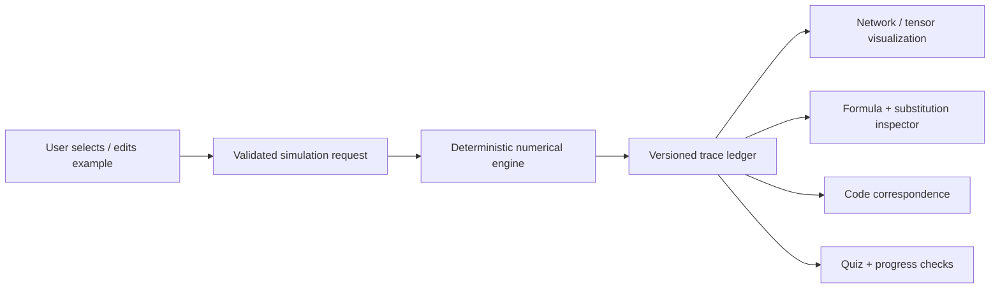

# Neural Network Learning Laboratory — Codex Master Build Specification

> **Purpose:** Build a mathematically rigorous, interactive web application that teaches neural networks by revealing **every transformation, equation, intermediate value, gradient, parameter update, and shape change**. This document is the source of truth for Codex. Work **one phase at a time** and do not silently skip acceptance tests.
>
> **Working name:** Neural Network Learning Laboratory (NNLL)
>
> **Primary learner:** A student who wants to understand neural networks from first principles through hands-on numerical experiments, not just watch animations or use a black-box trainer.

---

## 0. Instructions for Codex (READ FIRST)

You are an experienced full-stack engineer, numerical computing engineer, and deep learning educator. Implement this project as a **local-first, modular, test-driven teaching application**. Explain the mathematics accurately, with consistent notation and traceable intermediate numerical values.

### Operating rules
1. **Do not build every phase at once.** Implement only the explicitly requested phase. If no phase is stated, start at **Phase 0**.
2. Before editing code, inspect the existing repository and summarize what is already implemented, what is missing, and any relevant limitations.
3. For the current phase, provide: goals, touched files, technical approach, equation list, UI interaction list, test strategy, and any dependencies on prior phases.
4. Implement end-to-end vertical slices: **working calculation engine + interactive visualization + accessible explanation + automated tests + documentation**. Do not build nonfunctional mock controls.
5. **Never fake computations**. Every displayed value, plotted point, gradient, weight update, and animation must be derived from the actual computation state. Label purely illustrative conceptual animations as schematic.
6. Use tiny deterministic examples first. Fixed seeds and reproducible steps are required. Precision, rounding rules, and numerical tolerances must be explicit.
7. Display both symbolic equations and *numeric substitution* before a computed result. Show vector/matrix shapes at each step. Define every symbol and its units (if applicable).
8. Always separate model parameters, intermediate activations, gradients, hyperparameters, and inputs. Clarify what is learned and what is chosen by the user.
9. Explain **why** a mathematical operation is performed, not only **how**. Include edge cases and common misconceptions.
10. Preserve a shared, versioned computation-trace format, reusable by every simulator and frontend panel.
11. Complete a phase only after its acceptance tests pass; update `docs/PHASE_STATUS.md` and include a concise completion report with commands run and evidence. Do not claim tests passed unless actually executed.
12. If a major decision is unclear, adopt the documented default; record the decision in `docs/DECISIONS.md`. Avoid introducing paid services, API keys, or proprietary dependencies.
13. Do not refactor previous working labs unnecessarily; preserve backward compatibility with stored examples and trace schemas, or provide migrations.
14. Avoid scope creep. Future-phase UI may appear as clearly labeled roadmap links, but not as supposedly functional buttons.
15. On completion, give a suggested **next Codex prompt**, but do not proceed until the user explicitly requests the next phase.

### Definition of educational completeness
A topic is not complete unless a learner can:
- Describe its purpose and intuition in plain language;
- Identify input/output tensors, their shapes, and assumptions;
- Read the general equation and define every symbol;
- Work a tiny numerical example manually;
- Inspect each intermediate step in the application;
- Change a parameter and correctly predict the effect;
- Connect the operations to actual Python/PyTorch code;
- Check understanding with an exercise and receive reasoned feedback;
- Identify at least one limitation or common failure mode.

---

## 1. Product vision and learning principles

Build a web-based **inspectable neural network microscope**, not an ordinary course page. The central interaction is:

**Choose an architecture → construct a tiny example → step through computation → inspect formulas and substitutions → calculate loss → backpropagate derivatives → update parameters → repeat training → visualize what changed.**

All learning labs should support three coordinated views:

1. **Network / data view:** nodes, connections, kernels, sequence steps, feature maps, and decision boundaries.
2. **Math notebook view:** definitions, derivations, numeric substitutions, intermediate values, shapes, and gradient chain.
3. **Code view:** an equivalent NumPy or PyTorch example, showing how the exact computation maps to code. Code should be executable locally where practical; examples must not claim equivalence unless numerically tested.

### Teaching modes
- **Intuition:** analogies, visuals, concepts, terminology.
- **Guided calculation:** highlight one operand or transformation at a time.
- **Derivation:** chain rule, matrix calculus, convolution indexing, recurrence gradients.
- **Experiment:** edit inputs, weights, hyperparameters, or architecture and see recomputed traces.
- **Quiz / challenge:** predict a value or shape before revealing it.

### Global controls
Play / pause / next / previous / reset, playback speed when animation is used, step list, precision setting, seed, example selector, accessibility text alternatives, and a way to inspect complete computations without animation. **Previous** must render actual stored trace steps rather than reverse-engineering an animation.

---

## 2. Audience and outcomes

Start assuming understanding of basic arithmetic but not calculus or matrix algebra. Provide optional prerequisite lessons rather than assuming readiness.

After completing the curriculum a learner should be able to:
- Explain vectors, matrices, tensors, broadcasting, dot products, transposes, dimensions, derivatives, partial derivatives, and the chain rule;
- Compute a full forward and backward pass of a small DNN manually;
- Understand cross-entropy, MSE, sigmoid, tanh, ReLU, softmax, and their gradients;
- Explain gradient descent, SGD, mini-batches, Adam, initialization, normalization, and regularization;
- Calculate simple convolutions and see stride, padding, pooling, channels, and feature-map shapes;
- Unroll vanilla RNN computations through time and understand BPTT, vanishing/exploding gradients, LSTM, and GRU;
- Compare DNN, CNN, RNN, and later transformer/attention models, including appropriate use cases and trade-offs;
- Map math to NumPy and PyTorch and debug tensor shape and numerical stability problems.

---

## 3. Core UX requirements

### Application shell
- Home dashboard: progress, topic map, lab selection, saved examples.
- Prerequisite learning path and mathematical glossary.
- Architecture gallery: DNN, CNN, RNN, LSTM/GRU, optimizers, losses, regularization, and (later) transformers.
- Lesson layout: **Concept → Formula → Worked example → Interactive trace → Experiment → Quiz → Summary**.
- An inspectable **calculation ledger** with a record for each operation: operand values, variable names, shapes, formula, substitutions, output, narrative explanation, and previous/next operation references.
- Consistent selectable visual objects: clicking a neuron/edge/kernel cell/timestep/weight displays its role, equation, numeric value, upstream dependencies, and gradient (when applicable).
- Distinguish training data, held-out validation data, and test data. Visibly warn about data leakage when relevant.
- Clear resetting of weights versus clearing learner progress.

### Accessibility and reliability
- Keyboard-operable controls, sensible focus order, ARIA descriptions, contrast, reduced-motion mode, touch-friendly controls.
- Every animation also has a static table/equation alternative.
- Responsive from phone to wide desktop. Large matrices may scroll **within their local panel**.
- Formula rendering accessible to screen readers, ideally with a plain-language toggle.
- Local operation without model API calls. Export/import lesson state and trace JSON; do not store sensitive user data.

### Important pedagogy rule
Use **one consistent worked example** as a learner follows a network from input to output and backpropagation. Avoid switching weights or data without explicitly indicating a new example. Show full precision internally and configurable rounded display; identify when rounding causes small differences.

---

## 4. Technology stack and architecture

### Preferred implementation
- **Frontend:** Next.js (App Router), TypeScript, React, Tailwind CSS.
- **Visuals:** SVG + React for interactive small networks, matrices, tensors and convolution animations; use a plotting library such as Recharts for curves. Prefer precise, inspectable renderings over attractive but deceptive animation.
- **Equations:** KaTeX or MathJax with accessible fallbacks.
- **Numerical core:** Python 3.11+ using NumPy. Use PyTorch **only for optional parity checks and later full-scale examples**, never as the sole explanation of derivatives.
- **API:** FastAPI, Pydantic for validated simulation requests and trace responses.
- **Testing:** pytest for numerical core/API; Vitest and React Testing Library for components; Playwright for end-to-end workflows.
- **Persistence:** local examples via browser storage or local files initially, with schema versioning and explicit import/export. Database not needed for MVP.
- **Packaging:** monorepo with `apps/web`, `apps/api`, `packages` as needed; Docker Compose optional. Must be runnable locally on macOS without an NVIDIA GPU.

This is a **suggested stack**; versions should be chosen for compatibility when implementation begins, with dependencies pinned and explained. Network requests needed to install dependencies are distinct from product runtime; the learning app should work offline after initial setup where practical.

### Suggested modular directory structure

```text
neural-network-learning-lab/
├── README.md
├── AGENTS.md                         # Short Codex rules referring to this spec
├── docs/
│   ├── MASTER_PLAN.md               # Copy of this file
│   ├── PHASE_STATUS.md
│   ├── DECISIONS.md
│   ├── MATH_NOTATION.md
│   ├── TRACE_SCHEMA.md
│   ├── CURRICULUM.md
│   ├── VALIDATION_PLAN.md
│   └── phases/
├── apps/
│   ├── web/
│   │   ├── app/
│   │   ├── components/
│   │   │   ├── learning/
│   │   │   ├── network/
│   │   │   ├── tensor/
│   │   │   ├── math/
│   │   │   └── charts/
│   │   ├── features/
│   │   │   ├── prerequisites/
│   │   │   ├── dnn/
│   │   │   ├── cnn/
│   │   │   ├── rnn/
│   │   │   ├── training/
│   │   │   └── assessment/
│   │   └── tests/
│   └── api/
│       ├── app/
│       │   ├── main.py
│       │   ├── routes/
│       │   ├── schemas/
│       │   ├── core/
│       │   │   ├── tensors.py
│       │   │   ├── activations.py
│       │   │   ├── losses.py
│       │   │   ├── derivatives.py
│       │   │   ├── optimizers.py
│       │   │   └── tracing.py
│       │   ├── simulators/
│       │   │   ├── dense/
│       │   │   ├── convolution/
│       │   │   ├── recurrent/
│       │   │   └── training/
│       │   └── lessons/
│       └── tests/
├── examples/
│   ├── worked/
│   └── datasets/
├── scripts/
├── .github/workflows/
└── docker-compose.yml               # optional, only if helpful
```

### Data flow



### Boundary rules
- **Backend owns all canonical numerical computations**, including forward and backward traces. Frontend presents computed values; frontend may perform basic formatting and view-only geometry.
- Make computation modules pure and independently testable without web services.
- Small fixed examples must be available without external data.
- Never make a local LLM a dependency for mathematical correctness or explanation.
- Optional future AI tutor must cite trace steps, refuse to fabricate results, and be clearly separable from canonical math.

---

## 5. Math conventions and trace contract

### Global notation (document in `docs/MATH_NOTATION.md`)
- Scalars: lowercase italic (e.g., \(b\), \(\eta\)); vectors: lowercase bold or clearly typed \(x\); matrices: uppercase \(W\).
- Prefer column-vector convention for hand calculations: \(z^{(l)}=W^{(l)}a^{(l-1)}+b^{(l)}\); \(a^{(l)}=\phi(z^{(l)})\). Matrix \(W^{(l)}\) has shape \((n_l,n_{l-1})\).
- Clearly document any row-batch computational convention and its transpose relation to the math convention.
- \(L\) = loss, \(\eta\) = learning rate, \(\delta^{(l)} = \partial L / \partial z^{(l)}\).
- Explicitly identify whether reported MSE means \(\frac1N\sum_i(\hat y_i-y_i)^2\) or a half-squared-error convention; do not alternate silently.
- Define whether CNN is using true mathematical convolution (kernel-flipped) or **cross-correlation** (standard in DL frameworks). Default to cross-correlation and explain the distinction.
- Define RNN state \(h_t\), input \(x_t\), target \(y_t\), timestep \(t\), and time-unrolled weight sharing.
- When using softmax + cross-entropy, show the stable log-sum-exp computation and the simplified gradient under stated assumptions.
- For batches, show batch axis placement, gradient averaging and loss reductions.

### Trace step schema (minimum)
A versioned JSON model with:
- `trace_version`, `simulation_id`, `architecture`, `seed`, `precision_policy`, `config`;
- ordered `steps` with `step_id`, `phase` (forward/loss/backward/update), `operation`, `description`, `equation_latex`, `substitution_latex`, `input_refs`, `output_refs`, `input_shapes`, `output_shapes`, `values`, `tensor_indices`, `highlight_targets`, `derivation_notes`, `code_mapping`;
- explicit `initial_parameters`, `parameters_at_step` or parameter-version references, `gradients`, and `final_parameters`;
- warnings or error fields for invalid parameters, non-finite results, shape mismatches.

Use **numeric JSON-safe values** and explicit shape arrays; serialize NaN/Infinity only as validated error states, never as silent nulls. Include test fixtures for at least one full DNN forward/backward/update pass. Avoid storing identical huge tensors on every step: support references or bounded snapshots.

### Mandatory consistency checks
1. Displayed symbolic operation matches the actual code operation.
2. Numeric substitution recomputes to the output within the declared tolerance.
3. Shapes are mathematically correct at every step.
4. Analytical derivatives agree with central finite differences on tiny examples (where differentiable) and an independent PyTorch autograd reference when available.
5. Reset and replay with the same seed produce identical traces (under a pinned runtime).
6. Loss decreases on at least one well-conditioned tiny deterministic training case; do **not** claim monotonic loss for all optimization settings.

---

## 6. Curriculum: concepts that must be covered

### A. Math prerequisites
- Numbers, functions, domain/range, graphs, linear vs nonlinear functions.
- Scalars, vectors, matrices, higher-order tensors, indexing, rank, shape, transpose, dot product, matrix multiplication, elementwise multiplication, broadcasting.
- Summations, means, variances, standard deviations, normalization.
- Exponentials and logarithms; sigmoid, tanh and softmax foundations.
- Limits (intuitive), slopes, derivatives, partial derivatives, gradients, Jacobians and chain rule.
- Gradient descent as following a local slope; directional derivatives; finite-difference approximations.
- Probabilities and classification logits vs probabilities.

### B. DNN fundamentals
- Artificial neuron, inputs, bias, weights, receptive connections and hidden layers.
- Layer depth vs width; what makes a network *deep*.
- Per-neuron scalar computations, then full matrix formulation.
- ReLU, leaky ReLU, sigmoid, tanh, identity, softmax, derivatives and saturation.
- Regression vs binary classification vs multiclass classification, appropriate output activations and losses.
- MSE, MAE (nondifferentiability/subgradients), BCE, categorical cross-entropy, reduction choices.
- Full forward pass, output, loss, backward pass and chain rule; parameter gradients and updates.
- SGD, momentum, RMSProp, Adam, learning-rate schedules and what state each optimizer keeps.
- Parameter initialization (zeros/symmetry, Xavier/Glorot, He/Kaiming), random seeds.
- Batches, mini-batches, epochs, shuffling; validation/test distinction; overfitting/underfitting, generalization and leakage.
- L1/L2, dropout (train/eval behavior), early stopping, batch normalization/layer normalization (with careful train/eval details), gradient clipping.
- Numerical stability, exploding and vanishing gradients, dead ReLUs and gradient checking.

### C. CNN
- Images as H×W×C tensors; spatial structure and receptive fields.
- Cross-correlation kernel multiplication **cell by cell**; multiple kernels and output channels.
- Stride, padding, dilation, kernel size, bias, channels-first/last conventions, output shapes.
- Formula (per spatial dimension): \(O=\lfloor (I+2P-D(K-1)-1)/S +1 \rfloor\).
- Filter reuse/parameter sharing; feature maps and activation maps.
- Pooling (max/average) with element selection, backward routing for max pooling including documented tie convention.
- CNN layers → flatten/global-average-pooling → classifier; trainable parameter counting.
- Convolutional backpropagation: gradients w.r.t. input, kernel, and bias; stepwise tiny example.
- Filters and detected patterns (avoid asserting arbitrary learned filters always detect specific semantic edges); architecture comparisons and common errors.

### D. RNN, LSTM, GRU
- Ordered sequence input, timesteps, shared weights, hidden state and recurrence.
- \(h_t=\tanh(W_{xh}x_t+W_{hh}h_{t-1}+b_h)\), output equations and shape annotations.
- One-to-one, one-to-many, many-to-one, many-to-many tasks; teacher forcing conceptual explanation.
- Unrolling through time, loss accumulation, BPTT with shared-weight gradient sums.
- Gradient propagation over time, vanishing/exploding gradients, truncation and clipping.
- LSTM gates (forget, input, candidate, output), cell state, numerical gate calculations, memory transfer.
- GRU update/reset gates, candidate state; indicate specific algebraic convention used.
- Padding, masking, variable-length sequences; bidirectionality and limits of recurrent processing.

### E. Comparative and advanced modules
- DNN vs CNN vs RNN: learned inductive biases, parameter reuse, data organization, compute and limitations.
- Transformer introduction, embeddings, positional encodings, scaled dot-product attention, multi-head attention, masks, feed-forward blocks, residual connections and normalization; use miniature numeric examples.
- Model evaluation: accuracy, precision, recall, F1, confusion matrix, R², MAE/RMSE, cross-entropy and metric selection.
- Optional interoperability with existing RAG/memory/context-window learning projects **without importing their internal assumptions or making them prerequisites**.

---

## 7. Phase-by-phase implementation roadmap

**Rule:** Each phase must have a functioning artifact, worked example, docs, and automated tests. Use phases in order; do not jump to future topics until earlier math primitives are reliable.

| Phase | Delivery | Teaching objective | Acceptance gate |
|---|---|---|---|
| **0** | Repository foundation & design system | Define terms, trace schema, learning path and app shell | App/API start locally; health check; lint/test scripts run; phase-status and decisions docs exist |
| **1** | Interactive math foundations | Shapes, matrices, dot products, derivatives, chain rule | Calculator reproduces hand-worked examples and detects shape errors |
| **2** | Single-neuron microscope | Weighted sum, bias, activation, one sample | Click input/weight/bias and see exact numeric substitution and output |
| **3** | Multi-layer DNN forward pass | Layer-by-layer scalar and matrix multiplication | Editable 2→3→1 network; independently verified numerical outputs/shapes |
| **4** | Loss functions & tasks | Regression, binary/multiclass predictions, loss | MSE/BCE/CE trace, stable log/softmax, labeled assumptions |
| **5** | Backpropagation microscope | Chain rule from output back to every parameter | Manual scalar derivation, vector derivation, finite difference checks, autograd parity |
| **6** | Training & gradient descent lab | Weight updates, epochs, batches, convergence | Real train loop; synchronized plots/traces; reproducible replay |
| **7** | Activation, initialization & optimizer lab | Training stability, SGD/momentum/RMSProp/Adam | Different settings produce genuine compared runs with numerical checks |
| **8** | Generalization & training diagnostics | Validation/test, scaling, regularization, overfit | Real hold-out evaluations, leakage warnings, learning curves |
| **9** | CNN convolution lab | Pixels, kernels, channels, stride/padding | Editable small image/kernel; every window multiplication viewable |
| **10** | CNN complete pipeline & backward pass | Pooling, CNN architecture, gradients | Verified full tiny CNN, shapes and finite-difference gradients |
| **11** | Vanilla RNN forward simulator | Sequences, hidden state and shared weights | Numeric timestep-by-timestep replay with visible state carry-over |
| **12** | RNN BPTT & limitations | Temporal gradients, truncation, clipping | Verified gradients over multiple timesteps; illustrated failure cases |
| **13** | LSTM and GRU simulator | Gates, cell state, gradient pathways | Each gate formula/substitution inspected in deterministic examples |
| **14** | Compare architectures & assessment | Decide when/why to use each architecture | Side-by-side examples, quizzes with feedback, learner progress |
| **15** | Transformers & attention extension | Bridge classical DL to modern architectures | Inspectable Q/K/V, attention scores, masking, normalized weights |
| **16** | Harden, document, package and release | Reliable reusable lab | E2E and accessibility tests, tutorials, docs, release checklist |

### Detailed phase instructions

#### Phase 0 — Project foundation
Deliver a minimal Next.js UI with sidebar/topic cards; FastAPI health endpoint; typed simulation request/response prototype; shared terminology and math conventions; local run scripts and `AGENTS.md`. Scaffold vertical feature folders. Establish CI, linter, formatter, TypeScript strict mode, Python typing and smoke tests. No invented simulation outputs.

**Acceptance:** Fresh clone setup documented; UI and API run on Mac; trace schema sample validates; accessible keyboard navigation; CI exercises both components.

#### Phase 1 — Mathematical building blocks
Implement interactive calculators for scalar arithmetic, vector dot product, matrix-vector product, transpose, shapes, basic derivatives, chain-rule diagrams, and finite-difference slope visualization. Each operation displays formula → operands → indexed multiplication/addition → result. Include validation and explainer exercises.

**Acceptance:** Example \([2,3]\cdot[4,5]=23\); shape mismatch is explained instead of crashing; a compositional derivative is shown numerically and symbolically; unit tests cover broadcasting conventions.

#### Phase 2 — A single neuron
Let learner adjust \(x_1,x_2,w_1,w_2,b\). Compute \(z=w_1x_1+w_2x_2+b\) and \(a=\phi(z)\). Choose identity, sigmoid, tanh, ReLU. Highlight each multiply/add, then activation; show effect of bias, zero/negative values and saturation. Keep one reproducible preset.

**Acceptance:** Every displayed value matches engine output; each parameter selected shows contribution; clear shape and role labels; reset restores preset.

#### Phase 3 — Multi-layer DNN forward propagation
Implement 2→3→1 network with editable inputs and parameters; inspect individual neurons and full matrices. Display layer-wise \(z^{(l)}\) and \(a^{(l)}\). Distinguish hidden and output activations, show parameter counts and graph dependencies.

**Acceptance:** Verified deterministic fixture with all neuron-level intermediate values; invalid layer shapes blocked; UI switching scalar/matrix view leaves computed state unchanged.

#### Phase 4 — Predictions and loss
Explain continuous targets vs classes, logits vs probabilities, MSE, sigmoid+BCE, softmax+CE. Show target, prediction, sample loss, batch reduction and derivatives when helpful. Numerically stable logarithms and softmax required.

**Acceptance:** Reference test cases for each task; no log(0) crash; correctness of loss reduction verified against NumPy/PyTorch or a separately checked reference.

#### Phase 5 — Backpropagation
Implement a **full worked forward→loss→backward trace** for a small DNN; show gradients with respect to each \(W^{(l)}\), \(b^{(l)}\), activation and preactivation, with chain-rule dependency graph. Provide a check-by-hand mode (learner predicts one derivative), local numerical gradient checker, and optional PyTorch parity check. Discuss nondifferentiability at ReLU 0 and selected subgradient.

**Acceptance:** Every trainable parameter has an inspectable derivative; central differences match smooth-case analytical gradients within tolerance; gradient checks are automatically excluded or specially handled at non-smooth points.

#### Phase 6 — Training engine
Create deterministic training from a synthetic dataset (e.g. linear regression or XOR when architecture is appropriate). Add a training step button, epoch/mini-batch control, learning rate, weight charts, parameter table, training loss and decision boundary when 2D. Each step must be linked to a trace. Make clear full batch vs SGD.

**Acceptance:** Run training and reproduce on reset with same seed; snapshots map correctly to losses; show meaningful changes for different learning rates; handle divergence without corrupting state.

#### Phase 7 — Optimizers and training dynamics
Add activations comparison, initialization distributions, SGD, momentum, RMSProp, Adam (including bias correction), learning-rate schedules. Display optimizer state variables and parameter updates. Demonstrate saturation/dead ReLU and poor initialization with controlled cases.

**Acceptance:** One-step optimizer updates match reference calculations; optimizer states persist correctly between steps and reset properly.

#### Phase 8 — Generalization and diagnostics
Provide train/validation/test division, feature scaling fitted on training only, batch sizes, learning curves, early stopping, L2, dropout train/eval, normalization concepts, classification and regression metrics. Small in-browser synthetic dataset or API-generated examples; clear warning on leakage.

**Acceptance:** User can observe overfitting in a reproducible scenario; scaler never fitted on validation/test; eval disables dropout; validation results do not act as test outcomes.

#### Phase 9 — CNN cell-by-cell
Use a small grayscale numeric image (e.g. 5×5) and 3×3 kernel. Show one receptive field at a time; multiply nine pairs and sum bias. Let learner control kernel, stride, padding and see output shape. Advance from grayscale to RGB and multiple filters. Explicitly label operation **cross-correlation**.

**Acceptance:** Every output feature-map cell can be reconstructed from exposed multiplication ledger; shape formula checked; invalid kernel/stride/padding rejected with explanation.

#### Phase 10 — CNN end-to-end and gradients
Add ReLU, max/average pooling, flatten or global average pooling, dense output, classification loss. Teach backward gradients through convolution and pooling, including max-pool argmax selection. Explain tied maxima convention and gradient routing.

**Acceptance:** Tiny CNN gradients checked numerically away from nondifferentiable points; output dimensions and parameter counts match verified formulas.

#### Phase 11 — RNN forward over time
Implement tiny scalar or low-dimensional vanilla RNN processing a short sequence. Visualize unrolled recurrent cell, input vector, previous hidden state, candidate, current hidden state and prediction at each step. Controls for initial state, shared weights and sequence length.

**Acceptance:** Manually checked multi-timestep trace; verify hidden state at each timestep; changing one input propagates appropriately forward in time.

#### Phase 12 — RNN backpropagation through time
Show temporal computational graph and all chain-rule paths, accumulated shared-weight gradients, optional truncation and gradient clipping. Use controlled examples to demonstrate vanishing/exploding gradient magnitude; explain why training can be difficult.

**Acceptance:** Analytical gradients agree with independent finite differences or autograd; display correct temporal gradient summations and clipped vs raw gradients.

#### Phase 13 — LSTM/GRU internals
Teach each sigmoid/tanh gate with formula, dimensions, operand multiplication, gate value, cell/hidden state updates. Compare vanilla RNN vs LSTM vs GRU on a tiny sequence using documented example parameters.

**Acceptance:** Each gate value and state reproducible and independently tested; display the exact GRU convention used; no false claim that LSTM eliminates all gradient problems.

#### Phase 14 — Compare, assess, and personalize learning
Side-by-side architecture comparison on fixed example tasks; concept maps, graded calculation exercises, shape prediction, mastery checklist, progress export/import and misconception feedback. No LLM is necessary.

**Acceptance:** Assessment checks answers against actual computed truth and provides explanations; progress persists per design; accessibility and reset tested.

#### Phase 15 — Transformer extension (after classical foundations)
Implement token embeddings and position, dot-product attention with Q/K/V matrices, scaling by \(\sqrt{d_k}\), masking, row-wise softmax, weighted values, multiple heads, residuals and normalization in small examples. Distinguish self-attention from recurrence.

**Acceptance:** Full numeric attention matrix is traceable and each unmasked softmax row sums to 1 within tolerance; mask behavior tested.

#### Phase 16 — Release preparation
Comprehensive end-to-end tests; accessibility audits; reproducible worked-example library; documentation for each formula; offline/local run instructions; module performance budget; regression suite and an instructor-friendly quickstart. Package runnable local build and GitHub release notes.

**Acceptance:** All earlier phase gates pass in CI; clean install works; no fake/nonfunctional screens; consistent notation and schema.

---

## 8. Standard lesson template (required for every concept)

Each concept must include these fields (JSON or typed record as appropriate):

```yaml
id: unique-topic-id
prerequisites: [prior-topic-id]
learning_objectives: [specific observable outcomes]
intuition: why this concept exists
terminology: glossary links
symbolic_formula: LaTeX expression
symbol_definitions: every variable, shape, assumption
worked_example:
  inputs: small reproducible numbers
  substitutions: full arithmetic ledger
  output: checked value
interactive_controls: meaningful parameters and safe ranges
visualization: linked graph or tensor state
code_equivalence: tested NumPy/PyTorch snippet
common_misconceptions: [with corrections]
edge_cases: [with explanations]
practice_questions: [with verifiable answers and feedback]
acceptance_tests: [numerical and interaction checks]
```

### Example: neuron

Given \(x=[2.0,1.5]^T\), \(w=[0.4,0.7]\), \(b=0.1\):

\[
 z=wx+b=(0.4\times2.0)+(0.7\times1.5)+0.1=1.95
\]

\[
 a=\operatorname{ReLU}(1.95)=\max(0,1.95)=1.95
\]

Display the individual multiplication terms 0.8 and 1.05, their partial sum 1.85, then bias addition 1.95. A learner clicking the `0.7` weight should see that it contributes \(0.7\times1.5=1.05\). Changing `x₂` to zero must update **all** affected values in the visualization, trace, and code explanation.

### Example: small backpropagation derivation

For a neuron with identity activation and \(L=\frac12(\hat y-y)^2\) **only within this explicitly labeled half-squared-error exercise**:

\[
\frac{\partial L}{\partial w_i}
=\frac{\partial L}{\partial \hat y}
\frac{\partial \hat y}{\partial z}
\frac{\partial z}{\partial w_i}
=(\hat y-y)(1)x_i.
\]

The lesson must then substitute numbers, show every factor, display one weight update \(w_i' = w_i-\eta\frac{\partial L}{\partial w_i}\), and contrast this chosen half-error convention with the MSE convention used elsewhere. Never mix conventions without stating so.

---

## 9. Data, numerics, and security safeguards

- Prefer small built-in synthetic datasets and deterministic pedagogical cases over importing complex data initially.
- Validate matrix dimensions and hyperparameter ranges on **both** frontend and API. Reject oversized tensor configurations to avoid freezing the computer.
- Never run arbitrary user-supplied Python on the server. Code view is educational, not an untrusted remote execution service.
- Apply request-size limits, safe execution budgets and input validation.
- Keep computation local and avoid external uploads by default.
- Make floating-point tolerances explicit; show underflow/overflow concepts responsibly.
- Add unit tests for zero inputs, negative values, extreme sigmoid logits, degenerate shapes, non-finite input, clipping and reset/replay.
- Give accurate caveats when an example is for intuition but does not generalize to production training.

---

## 10. Verification strategy

### Unit tests
- NumPy arithmetic, activation forward/derivatives, all losses, numerical stability.
- DNN forward and backward with independent worked solutions.
- Convolution output shapes, element computations, backward numerical checks.
- RNN temporal states and BPTT, LSTM/GRU gates, attention masking.
- Optimizer state transitions and batch-reduction behavior.

### Integration tests
- API request → validated numerical trace → frontend equation and displayed number.
- Selection of individual graphical objects → inspector displays matching state.
- Changed inputs → all dependent computations refresh, with no stale values.
- Persisted state → correct restore/version behavior.

### End-to-end tests
- Learner completes one guided lesson entirely via keyboard.
- Learner manually predicts a value, checks it, sees why it is correct/incorrect.
- Learner trains a model, modifies learning rate, resets, and reproduces results.
- Learner navigates from DNN to CNN/RNN labs without losing unrelated progress.

### Documentation standard
Every module needs: conceptual explanation, symbol table, derivation, verified numeric example, code correspondence, assumptions, edge cases, practice problem, and sources for external mathematical claims when relevant. Use primary references or official framework docs; do not fabricate citations.

---

## 11. Codex phase workflow and commands

### Initial prompt to Codex

```text
Read NEURAL_NETWORK_LAB_CODEX_MASTER_PLAN.md completely. Treat it as the canonical
requirements document. Inspect this repository (or initialize a new one if empty).
IMPLEMENT PHASE 0 ONLY. Before coding, summarize the scope, architecture,
file changes, equation/trace contracts, and acceptance criteria. Then build the
working frontend and backend foundation, tests, docs, and README. Run applicable
tests. Update docs/PHASE_STATUS.md and docs/DECISIONS.md. Give me instructions
to run the application locally on my Mac. Do not start Phase 1.
```

### Next-phase prompt template

```text
Read NEURAL_NETWORK_LAB_CODEX_MASTER_PLAN.md and docs/PHASE_STATUS.md.
IMPLEMENT PHASE [N] ONLY. Inspect existing code first and preserve working
features. Build the canonical math engine, complete numerical trace, user
interaction, explanatory material, worked example, tests, and documentation
required for this phase. Run checks and update phase status. Show me what to
click to verify the learning objectives. Do not start Phase [N+1].
```

### Bug-fix / correctness prompt

```text
Investigate [describe problem] in Phase [N]. Reproduce the bug with a failing
test. Check formulas, shapes, substitutions, trace consistency and displayed
numbers. Fix the underlying computation or UI binding without hardcoded fake
results. Run affected tests plus regressions; document the fix. Do not add new
features or start the next phase.
```

### Educational-depth review prompt

```text
Audit Phase [N] as a mathematics instructor and numerical-computing reviewer.
For every formula, confirm notation, assumptions, dimensions, substitutions,
computed outputs and chain-rule steps. Identify explanations that skip a step,
mislead beginners, or mismatch the running code. Add the missing worked
intermediates and tests. Report exact changes and remaining limitations.
```

---

## 12. Phase tracker format

Maintain `docs/PHASE_STATUS.md` as a table with: `Phase`, `Status (not started / in progress / verified)`, `Features delivered`, `Worked example`, `Tests executed`, `Known limitations`, `Next action`. Never mark verified without recorded evidence.

Maintain `docs/DECISIONS.md` with timestamped architecture decisions, why they were made, and alternatives considered.

Maintain `docs/MATH_NOTATION.md` with symbol definitions and layer/batch conventions. Version `docs/TRACE_SCHEMA.md` and any trace fixtures whenever schema changes.

---

## 13. MVP vs full product

**First educational MVP = Phases 0–6.** At that point, a learner can follow a DNN from input values to prediction, loss, gradients, weight updates, and actual training. That should be polished and mathematically correct before beginning CNN/RNN.

**Full classical neural-network course = Phases 0–14.** CNN and RNN share the trace, math, visualization, and testing foundations already built.

**Extended neural-network curriculum = Phases 0–16.** Adds attention/transformers and release-hardening.

### Explicit non-goals at launch
- Training large production models or downloading enormous datasets.
- User authentication, cloud deployments, paid model APIs, and chatbot dependencies.
- Live collaborative classrooms.
- Treating attractive diagrams as a substitute for mathematical verification.

---

## 14. Final instruction to Codex

**Optimize for deep learner understanding, mathematical truth, traceability and robust design over feature count.** Every small step must be inspectable. If a concept requires several multiplications, the app must let a learner see those multiplications. If a parameter changes, the full downstream computation must change. If a gradient is shown, it must be backed by the correct chain rule and a numerical check. Build carefully, demonstrate each phase in the UI, and never proceed beyond the phase explicitly assigned.
